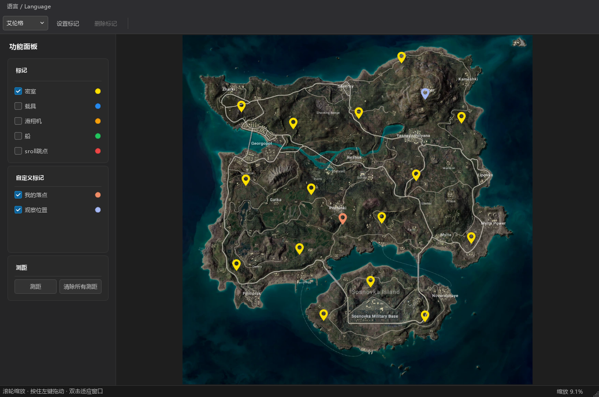
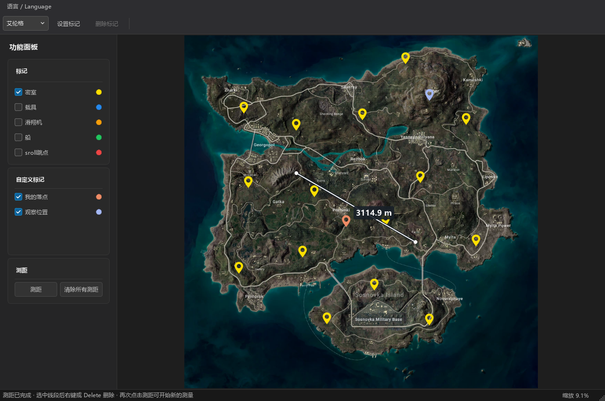

# 吃鸡之路 · Road to Chicken Dinner

一款面向 Windows 的非官方 PUBG 桌面地图工具。查看地图和内置点位，记录个人落点，并使用两点测距辅助地图研究。

本仓库用于维护**软件官网、公开使用说明与版本发布**，不包含桌面软件源码。

[软件官网](https://nievan.github.io/road-to-chicken-dinner/) · [版本发布与下载](https://github.com/NieVan/road-to-chicken-dinner/releases) · [反馈问题](https://github.com/NieVan/road-to-chicken-dinner/issues)

## 软件界面





截图来自软件实际界面。“我的落点”“观察位置”为演示用的自定义标记，不是软件默认提供的点位。

## 主要功能

- 九张地图：艾伦格、米拉玛、维寒迪、泰戈、帝斯顿、荣都、萨诺、帕拉莫、卡拉金。
- 鼠标滚轮缩放、拖动平移、双击适应窗口；地图切片按窗口和缩放比例加载。
- 按地图提供密室／安全门／金库、载具、滑翔机、船、熊洞、地下室等内置分类。
- 查看已配置的萨诺物资车北、东、南、西四条线路，以及地下室范围。
- 自定义标记类型的名称、颜色及点位；支持选中删除和右键删除整个类型。
- 两点测距，显示地图平面直线距离，单位为米，保留一位小数。
- 深色界面；支持简体中文和 English，记住上次选择。

可显示的类别和实际点位数量以发布包内容为准。地图、点位数据可能随游戏更新发生变化，载具标记不代表保证刷新；测距不包含地形高度差。

## 下载与启动

国内备用下载：[百度网盘完整版 v1.0.2](https://pan.baidu.com/s/1CT3ucZoHTscfMEynS4Rt7g?pwd=dcqx)，提取码：**dcqx**。链接已附带提取码，如未自动填入请手动输入。

1. 在 [Releases](https://github.com/NieVan/road-to-chicken-dinner/releases) 下载文件名含 **full** 的 Windows 64 位完整版。当前版本为 **v1.0.2**。
2. 完整版已包含程序、运行库和地图资源，无需另行下载或合并地图包。
3. 将 ZIP 完整解压到有写入权限的目录，保留其中所有文件和子目录。
4. 打开解压得到的 `Road to Chicken Dinner` 文件夹，双击其中的 `Road to Chicken Dinner.exe` 启动。

不要只移动一个 EXE 文件。Qt 运行库、插件和配置资源需要保留在正确位置；无需安装 Qt、Node.js 或数据库。

目录示例：

```text
Road to Chicken Dinner/
├─ Road to Chicken Dinner.exe
├─ Qt5Core.dll、Qt5Gui.dll、Qt5Widgets.dll 等运行库
├─ platforms/
├─ imageformats/
└─ config/
   ├─ map/                   地图资源
   ├─ markers.json           软件内置标记
   ├─ custom_markers.json    个人标记类型和点位（首次创建时生成）
   └─ settings.ini           语言等设置
```

## 基本操作

| 操作 | 方法 |
| --- | --- |
| 切换地图 | 顶部地图下拉框 |
| 放大／缩小 | 鼠标滚轮 |
| 移动地图 | 按住鼠标左键拖动 |
| 适应窗口 | 非编辑状态下双击地图 |
| 筛选内置标记 | 勾选左侧“标记”中的类别 |
| 筛选个人标记 | 勾选左侧“自定义标记”中的类型；较多时滚动列表 |
| 切换语言 | 顶部“语言 / Language”菜单 |

### 创建个人标记

1. 点击工具栏“设置标记”。
2. 在弹窗中输入类型名称，选择颜色，点击“创建新标记类型”。
3. 在列表中选中该类型，点击“设置标记”。
4. 在地图上单击位置，为点位输入名称并保存。可以继续单击添加更多点。
5. 再次点击工具栏“设置标记”结束标点。

类型在所有地图中共用，点位按地图分别保存。自定义名称由你输入，不随界面语言自动翻译。

### 删除个人标记或类型

- **删除单个点**：选中个人标记，点击“删除标记”或按 Delete。
- **删除整个类型**：打开“设置标记”，右键点击类型，选择“删除标记类型”，确认后删除。
- 删除类型会同时删除该类型在**所有地图中的点位**；取消确认则保留原数据。
- 用户版可查看内置标记及线路，但不能添加、修改或删除它们。

### 测距

1. 点击左侧“测距”，单击起点。
2. 移动鼠标，预览线段和距离。
3. 再单击终点，固定测距并结束本次测距模式。

选择终点前，右键可以撤销起点并继续测距；Esc 清空未完成的测距。选中已完成的测距线后，可按 Delete 删除，或使用右键菜单；“清除所有测距”按钮清空当前地图的测距线。

测距线不保存到配置文件，切换地图或关闭软件后清空。

## 备份与更新

- 重要的个人配置：`config/custom_markers.json`。更换电脑或更新软件前请备份。
- 语言等偏好保存在 `config/settings.ini`。
- 更新时遵循对应 Release 的说明，不要用空的个人配置覆盖已有文件。
- 从 v1.0.1 起，点击工具栏“检查更新”，有新版时可选择“立即更新”，自动下载、校验、安装并重启。
- 程序与地图分别判断版本；地图未变化时不会重复下载。自动更新保留个人标记和设置，安装失败时尝试恢复旧文件。
- v1.0.0 用户需先手动下载一次新版完整版，并将备份的个人配置复制到新版目录，之后即可在软件内更新。
- Releases 中的 program ZIP、maps ZIP 和 update.json 供软件自动更新使用，首次下载只需选择 full 完整版。

## 常见问题

**打开后没有地图？**

确认地图资源位于 EXE 同目录的 `config/map/` 下，且没有多套一层文件夹。每个地图目录应包含 `info.json` 和数字命名的切片层级目录。

**出现 DLL 缺失或“无法定位程序输入点”？**

重新完整解压同一版本的软件包，不要混用不同版本的 EXE 和 Qt DLL，也不要只从旧版本目录复制一个 EXE。

**标记保存失败？**

检查软件目录的写入权限及磁盘空间；建议解压到个人可写的文件夹。配置损坏时先备份，不要直接覆盖个人数据。

**是否需要账号、读取游戏数据？**

当前软件不要求账号登录，不读取游戏内存，也不自动获取游戏中的飞机航线、安全区或玩家位置。地图和标记在本地使用。

## 官网文件与部署

```text
index.html            官网页面
style.css             响应式样式
site.js               截图放大查看
images/               软件截图与网站标识
README.md             本使用说明
.nojekyll             直接发布静态文件
```

双击 `index.html` 可本地预览，正式发布无需安装前端依赖或运行服务器程序。

启用 GitHub Pages：

1. 打开仓库 **Settings → Pages**。
2. Source 选择 **Deploy from a branch**。
3. Branch 选择 **main**，目录选择 **/(root)**，点击 **Save**。
4. 等待部署完成，访问 `https://nievan.github.io/road-to-chicken-dinner/`。

软件压缩包和地图资源包应上传至 **Releases**，不直接提交到本仓库的文件列表。首次发布时，点击仓库的 Releases（或访问本 README 顶部的“版本发布与下载”链接），选择 **Create a new release / Draft a new release**，创建版本标签并上传附件。

发布新版本时，请同步更新首页下载区的版本号、完整版下载链接与说明。推荐用户下载 full 完整版，程序和地图分包继续供自动更新使用。

## 反馈与说明

请通过本仓库 [Issues](https://github.com/NieVan/road-to-chicken-dinner/issues) 反馈，附上软件版本、地图名称、复现步骤和必要截图。公开反馈前请移除个人信息及不希望公开的标记内容。

本工具为个人开发的非官方项目，与 PUBG 官方无隶属关系。PUBG 及相关游戏地图、商标等归相应权利人所有。本仓库公开用于官网与发布说明，不代表桌面软件源码或游戏素材获得开源授权。
